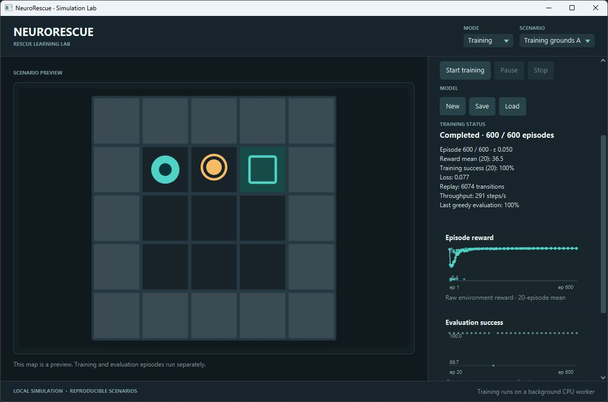
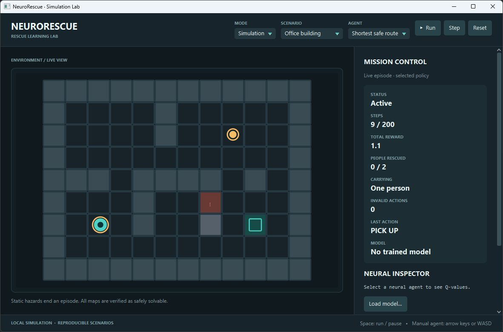
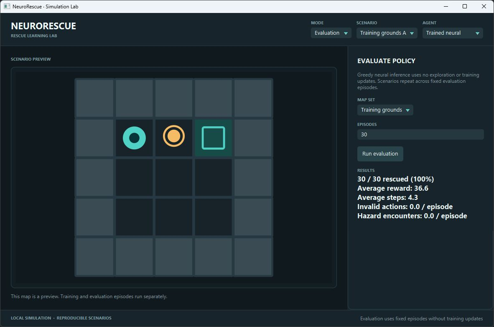
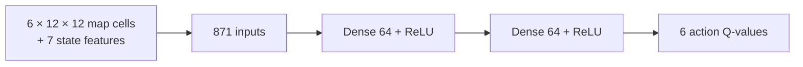

# NeuroRescue

**Teaching a rescue agent through trial, error, and feedback.**

NeuroRescue is a desktop rescue simulation and a small, inspectable reinforcement learning lab. A robot must find victims and bring them to an exit while avoiding walls, obstacles, and hazardous tiles. You can drive it yourself, let a shortest safe route algorithm plan its moves, or train a Deep Q-Network (DQN) to estimate which action is worth taking. The JavaFX interface shows the same environment used by the headless trainer and evaluation tests, making learned behavior something you can observe and measure.



*Local CPU training in JavaFX. The chart points correspond to measured episodes; the map is a separate scenario preview.*

## Why this project?

A route planner has a complete map and follows an explicit search algorithm. A DQN instead assigns values to possible actions and changes those estimates as it experiences rewards and failures. NeuroRescue puts both approaches in the same rescue task, so their behavior can be compared against identical rules. Keeping the simulator independent of JavaFX lets tests and experiments run headlessly; a small network keeps local JVM training practical on a CPU. The desktop interface makes the resulting behavior and measurements visible.

## What you can do

- **Simulate a rescue** with manual keyboard control, the shortest safe route agent, a fresh neural agent, or a trained one. Step through decisions or let the agent run.
- **Train locally** on fixed, validated maps. Follow episode reward, success, loss, replay size, exploration rate, throughput, and periodic greedy evaluation in the JavaFX panel. Training runs on a background worker.
- **Evaluate policies** over a chosen map set and see rescues, raw environment reward, episode length, invalid actions, and hazard encounters.
- **Save and load a model** for later inference. The `.nrdq` file stores weights and provenance, with format validation on load.
- **Run headless tests and an opt-in learning experiment** without opening the desktop interface.

## Inside the application

**Simulation.** Drive the robot with WASD or arrow keys, `P` to pick up, and `E` to drop off, or run an automatic agent. The inspector shows neural Q-values when a neural agent is selected.



**Training.** The opening screenshot shows a run after 600 episodes on the training grounds with seed 17. Reward and loss are recorded at the episodes the UI received; greedy evaluation appears only at its measured intervals. The map is a preview rather than a live training episode.

**Evaluation.** A trained model is evaluated greedily, without exploration or weight updates. This screenshot shows 30 rescues in 30 evaluations of the training grounds. Those evaluations repeat fixed layouts; the result does not establish performance on unseen maps.



## How the agent learns

The environment supplies an observation after each action. The encoder turns it into six 12×12 binary maps—walls, obstacles, hazards, exits, remaining victims, and robot position—plus seven normalized features for carrying state, position, and offsets to a nearby victim and exit. The DQN predicts one Q-value for each action: up, down, left, right, pick up, or drop off. A higher Q-value means the model currently expects a better future return from that action.

During training, an **epsilon-greedy** policy sometimes chooses a random valid action instead of the current best prediction. This lets it encounter outcomes its existing policy would miss. Impossible moves and premature pickup or drop-off are masked. Hazard moves remain possible, so avoiding them is part of the task.

| Event | Environment reward |
| --- | ---: |
| Every action | −0.1 |
| Invalid action | −1.0 additional |
| Pick up a victim | +2.0 |
| Deliver a victim | +15.0 |
| Complete the rescue | +20.0 additional |
| Enter a hazard | −10.0 and episode failure |

The trainer adds a bounded distance-based shaping reward for valid movement toward the current goal. Evaluation reports the **unshaped environment reward**. Each transition is stored in a replay buffer; minibatches mix past experiences during gradient updates. The Bellman target combines immediate reward with the best *valid* next-action value from a separate target network. Terminal transitions do not bootstrap. The network uses Huber loss and Adam, and the target network is copied from the online network periodically. At inference time the trained agent chooses greedily and does not update its weights.

The model is deliberately compact:



Its small size keeps local CPU experiments practical while still making the full learning loop visible. See [DQN design and rewards](docs/reinforcement-learning.md) for encoding, defaults, masking, and update details.

## What the controlled experiment found

The opt-in JUnit experiment starts with a fresh DQN, trains for **360 episodes** with seed 17 across three 5×5 training grounds, and evaluates policies with no neural exploration. Results from a CPU run on Windows (October 30, 2026):

| Policy / evaluation | Rescues | Mean raw reward |
| --- | ---: | ---: |
| Fresh DQN, training grounds | 0 / 30 | −3.20 |
| Random valid actions, training grounds | 5 / 30 | 4.32 |
| Shortest safe route, training grounds | 30 / 30 | 36.57 |
| DQN after training, training grounds | 30 / 30 | 36.57 |
| Trained DQN, held-out layouts | 0 / 20 | −2.20 |

The model learned the evaluated training layouts, reaching the baseline's rescue count there. It did **not** transfer to the two held-out layouts in this experiment. The 30 training-ground evaluations rotate through just three deterministic maps, so they are repeated trials of three cases rather than 30 independent environments. These results show learning on a controlled task, not general rescue competence. The test also saves and reloads the model and checks matching Q-values within `1e-5`. See the [experiment record](docs/experiments.md) for setup, steps, and interpretation.

## Engineering design

| Component | Responsibility |
| --- | --- |
| `simulation` | Validated maps, transitions, rewards, and immutable observations |
| `baseline` | Map-aware shortest safe route policy |
| `ai` | Encoding, action masking, replay, DQN training, evaluation, and model files |
| JavaFX application | Mode coordination; `SimulationView` renders the map; `MissionPanel` and `TrainingPanel` present episode and training data |

The simulation and trainer work without JavaFX, which makes them testable from JUnit and usable in repeatable experiments. A single worker serializes neural operations; queued training can be cancelled before a session starts, and active or paused training receives a stop request on shutdown. Training progress reaches the interface through JavaFX's application thread. The [architecture notes](docs/architecture.md) describe the threading and persistence boundaries.

**Stack:** Java 21 language level; JavaFX 21.0.6 for the desktop app; Maven and Maven Wrapper for builds; DJL 0.38.0 with PyTorch CPU 2.7.1 for neural computation; JUnit 5.12.1 for tests.

## Build and run

Install a **JDK 21 or newer**. The supplied Maven Wrapper downloads Maven on first use, and Maven downloads dependencies and native CPU libraries into its local cache. A graphical desktop is needed for the app; tests and the learning experiment can run headlessly. The current native profiles target Windows and Linux **x86-64**. The commands below were verified on Windows; Linux support is configured but was not verified in this run.

Windows (PowerShell):

```powershell
.\mvnw.cmd clean verify
.\mvnw.cmd javafx:run
```

Linux:

```sh
./mvnw clean verify
./mvnw javafx:run
```

The packaged JAR is a normal Maven artifact, not a self-contained desktop installer. Use `javafx:run` to start the app. After launch:

1. Choose **Training**, select **Training grounds**, set an episode count and seed, then press **Start training**. Training can be paused or stopped.
2. Press **Save** in Training mode to write a `.nrdq` model. To reopen it later, use **Load** there or **Load model…** in Simulation mode.
3. Choose **Trained neural** in Simulation mode to inspect and run the policy. Choose **Evaluation** to measure it on a selected map set. The shortest safe route and fresh neural agents provide comparisons.

Model files contain inference weights and metadata. Loading a model and starting another training run creates new replay and optimizer state; it does not resume an exact training checkpoint.

### Reproduce the longer learning experiment

The ordinary `clean verify` suite runs the fast tests; the 360-episode experiment is opt-in:

```powershell
.\mvnw.cmd '-Dtest=LearningExperimentTest' '-Dneurorescue.experiment=true' test
```

On Linux, replace `.\mvnw.cmd` with `./mvnw`. The test prints the initial, baseline, random, training-progress, final, and held-out evaluations. Its seed and map sequence are fixed; CPU execution time depends on the machine.

## Limits and next steps

The current world is simplified: hazards are static, episode transitions are deterministic after map creation, and there is one robot. Neural encoding supports maps up to **12×12**; larger maps can exist in the simulator but cannot be used by this DQN. The held-out result above makes generalization the clearest next research problem. More varied generated training and evaluation maps, multiple training seeds, improved curriculum design, and methods such as Double DQN would provide stronger evidence. The current `.nrdq` format is for inference, not exact training resumption.

## License

[MIT](LICENSE).
